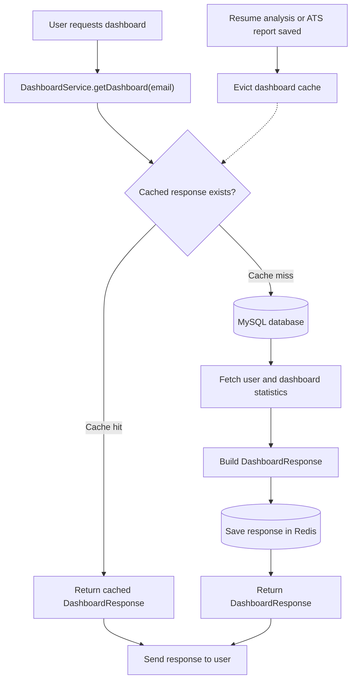

# 📄 ResumeAI — AI Powered Resume Analyzer & ATS Checker


---

**ResumeAI** is a full-stack AI-powered Resume Analysis and ATS Checking platform built using Spring Boot, JWT Authentication, Gemini AI, MySQL, Redis, HTML, CSS, and JavaScript.

It helps users analyze resumes, check ATS compatibility against job descriptions, generate AI-powered reports, and manage analysis history.

---

## 📋 Table of Contents

- [Features](#features)
- [Tech Stack](#tech-stack)
- [Redis Caching Architecture](#redis-caching-architecture)
- [Project Structure](#project-structure)
- [Database Schema](#database-schema)
- [API Reference](#api-reference)
- [Getting Started](#getting-started)
- [Running the Application](#running-the-application)
- [User Flow](#user-flow)
- [Screenshots](#screenshots)
- [Author](#author)
- [License](#license)

---

## ✨ Features

- 🔐 **Secure Authentication** — User registration and login powered by JWT-based authentication with Spring Security.
- 📄 **AI Resume Analysis** — Upload resumes in PDF, DOC, or DOCX format and receive AI-generated analysis reports.
- 📊 **Resume Quality Assessment** — Evaluate resume effectiveness through an intelligent scoring system.
- 🧠 **Key Skills Extraction** — Identify technical, professional, and domain-specific skills.
- 💡 **Personalized Improvement Suggestions** — Receive AI-driven recommendations to enhance resume quality.
- 📝 **Professional Resume Summary** — Generate concise summaries tailored to the uploaded resume.
- 🎯 **ATS Compatibility Checker** — Compare resumes against job descriptions.
- 📈 **ATS Score Calculation** — Generate an ATS compatibility score.
- ✅ **Matched Keywords Detection** — Identify skills aligned with job requirements.
- ❌ **Missing Keywords Analysis** — Highlight missing keywords and competencies.
- 📚 **Resume Analysis History** — Review previously generated resume analysis reports.
- 📊 **ATS Report History** — Access previous ATS evaluation reports.
- 🔍 **Advanced Search Functionality** — Search and filter resume and ATS history records.
- 📧 **Email Report Delivery** — Send AI-generated reports through email.
- 📄 **PDF Report Export** — Download reports in PDF format.
- 👤 **Interactive User Dashboard** — Monitor activity and report statistics.
- 📌 **Latest Performance Tracking** — View the most recent ATS score.
- 🔒 **Secure Backend APIs** — Spring Security and role-based access control.
- 🤖 **Gemini AI Integration** — Use Google's Gemini AI for resume analysis and ATS evaluation.
- ⚡ **Redis Dashboard Caching** — Cache dashboard responses to reduce repeated database queries.
- 📱 **Responsive User Interface** — Support desktop, tablet, and mobile screens.

---

## 🛠️ Tech Stack

| Technology | Purpose |
|---|---|
| Java | Backend language |
| Spring Boot | Backend framework |
| Spring Security | Authentication and authorization |
| JWT | Stateless authentication |
| Spring Data JPA | Database access |
| Hibernate | ORM |
| MySQL | Persistent database |
| Redis | Dashboard response caching |
| Spring Cache | Cache abstraction |
| Jackson | JSON serialization |
| Gemini AI | AI-powered resume analysis |
| Apache Tika | Resume document parsing |
| HTML | Frontend structure |
| CSS | Styling |
| JavaScript | Frontend logic |
| Maven | Build and dependency management |

---

## ⚡ Redis Caching Architecture

### Overview

ResumeAI uses Redis to cache dashboard responses and reduce repeated
database queries. Spring Boot's caching abstraction manages the cache,
and Redis stores the cached `DashboardResponse`.

### Architecture



### Cache behavior

1.  **Cache miss:** The first request for a user's dashboard runs
    `getDashboard(email)`, reads the required data from MySQL, creates a
    `DashboardResponse`, and stores the result in Redis.
2.  **Cache hit:** A later request with the same email returns the
    cached response without running the annotated service method again.
3.  **Expiration:** Cached entries expire after 10 minutes.
4.  **Eviction:** After a resume analysis or ATS report is saved, call
    `evictDashboardCache(email)` so the next dashboard request can fetch
    updated data. The diagram's eviction path works only if the
    application actually calls this method.

### Configuration

#### `application.properties`

```properties
spring.data.redis.host=localhost
spring.data.redis.port=6379
spring.data.redis.repositories.enabled=false
```

#### `RedisConfig.java`

Configure a `RedisCacheManager` with a 10-minute TTL, string keys, JSON
values, and null caching disabled. Adapt the serializer constructor to
match the `ObjectMapper` and Spring Data Redis version used by the
project.

```java
RedisCacheConfiguration config = RedisCacheConfiguration.defaultCacheConfig()
    .entryTtl(Duration.ofMinutes(10))
    .serializeKeysWith(
        RedisSerializationContext.SerializationPair.fromSerializer(
            new StringRedisSerializer()
        )
    )
    .serializeValuesWith(
        RedisSerializationContext.SerializationPair.fromSerializer(
            new GenericJackson2JsonRedisSerializer(objectMapper)
        )
    )
    .disableCachingNullValues();

RedisCacheManager cacheManager = RedisCacheManager.builder(connectionFactory)
    .cacheDefaults(config)
    .build();
```

Ensure caching is enabled once in your application, for example by
placing `@EnableCaching` on the main Spring Boot application class or a
configuration class.

#### `DashboardService.java`

```java
@Cacheable(value = "dashboard", key = "#email")
public DashboardResponse getDashboard(String email) {
    // Fetch dashboard data from MySQL and return DashboardResponse.
}
```

To remove a user's cached dashboard:

```java
@CacheEvict(value = "dashboard", key = "#email")
public void evictDashboardCache(String email) {
    // Spring removes the matching cache entry.
}
```

Call the eviction method after the relevant resume-analysis or
ATS-report save operation. The method declaration alone does not
automatically invalidate the cache.

### Verify Redis

Check that the Redis container is running:

```bash
docker ps
```

Connect using the container name shown by `docker ps`. If the container
is named `redis-server`, run:

```bash
docker exec -it redis-server redis-cli
```

Test the connection:

```redis
PING
```

Expected response:

```text
PONG
```

### Benefits

-   **Faster repeated dashboard requests:** Cache hits avoid re-running
    the dashboard service method.
-   **Lower database load:** Cached responses reduce repeated dashboard
    queries.
-   **Time-to-live (TTL):** Entries expire after 10 minutes.
-   **Cache invalidation:** Eviction allows the next request to retrieve
    updated dashboard data.
-   **JSON serialization:** Dashboard response objects are stored using
    the configured JSON serializer.

---

## 📁 Project Structure

```text
ResumeAnalyser
│
├── src
│   └── main
│       └── java
│           └── com.cfs.ResumeAnalyser
│               │
│               ├── config
│               │   ├── CorsConfig.java
│               │   └── RedisConfig.java
│               │
│               ├── controller
│               │   ├── AdminController.java
│               │   ├── AuthController.java
│               │   ├── ResumeController.java
│               │   └── UserController.java
│               │
│               ├── dto
│               │   ├── DashboardResponse.java
│               │   ├── DashboardStats.java
│               │   ├── LoginRequest.java
│               │   ├── LoginResponse.java
│               │   ├── RegisterRequest.java
│               │   └── ResumeAnalysisResponse.java
│               │
│               ├── exception
│               │
│               ├── model
│               │   ├── AtsReport.java
│               │   ├── ResumeAnalysis.java
│               │   └── User.java
│               │
│               ├── repository
│               │   ├── AtsReportRepository.java
│               │   ├── ResumeAnalysisRepository.java
│               │   └── UserRepository.java
│               │
│               ├── security
│               │   ├── JwtAuthenticationFilter.java
│               │   ├── JwtUtil.java
│               │   └── SecurityConfig.java
│               │
│               ├── service
│               │   ├── DashboardService.java
│               │   ├── EmailService.java
│               │   ├── GeminiService.java
│               │   ├── PdfService.java
│               │   └── ResumeService.java
│               │
│               └── ResumeAnalyserApplication.java
│
├── frontend
│   ├── index.html
│   ├── login.html
│   ├── register.html
│   ├── user-dashboard.html
│   ├── resume-analyzer.html
│   ├── ats-checker.html
│   ├── resume-history.html
│   ├── ats-history.html
│   ├── about.html
│   │
│   ├── css
│   │   └── style.css
│   │
│   └── js
│       ├── login.js
│       ├── register.js
│       ├── user.js
│       ├── resume-analyzer.js
│       ├── ats-checker.js
│       ├── resume-history.js
│       └── ats-history.js
│
├── pom.xml
└── README.md
```

*Note: Adjust the tree to match the actual files in your repository.*

---

## 🔗 API Reference

### Authentication

```http
POST /auth/register
POST /auth/login
```

### Resume Analysis

```http
POST /api/resume/analyze
GET  /api/resume/my-history
GET  /api/resume/search-history
```

### ATS Checker

```http
POST /api/resume/ats-check
GET  /api/resume/my-ats-history
GET  /api/resume/search-ats-history
```

### Dashboard

```http
GET /api/user/dashboard
```

---

## 🚀 Getting Started

### Clone Repository

```bash
git clone https://github.com/Shevendra77/resume_analyzer.git
cd resume_analyzer
```

### Create Database

```sql
CREATE DATABASE resume_analyser;
```

### Configure Application

Configure your database credentials and API keys using environment variables or your local configuration.

```properties
spring.datasource.url=jdbc:mysql://localhost:3306/resume_analyser
spring.datasource.username=${DB_USERNAME}
spring.datasource.password=${DB_PASSWORD}

gemini.api.key=${GEMINI_API_KEY}

spring.data.redis.host=localhost
spring.data.redis.port=6379
```

Configure the other required environment variables, including `JWT_SECRET` and email credentials, if those features are enabled.

### Start Redis

If your existing Redis container is named `redis-server`, start it with:

```bash
docker start redis-server
```

Verify that it is running:

```bash
docker ps
```

### Install Dependencies

```bash
mvn clean install
```

---

## ▶ Running the Application

### Backend

```bash
mvn spring-boot:run
```

Backend URL:

```text
http://localhost:8080
```

### Frontend

Open the frontend using VS Code Live Server.

Frontend URL:

```text
http://localhost:5500
```

---

## 👨‍💻 User Flow

```text
Register
   ↓
Login
   ↓
Dashboard
   ↓
Resume Analyzer
   ↓
Resume History
   ↓
ATS Checker
   ↓
ATS History
   ↓
Logout
```

---

## 📸 Screenshots

Add screenshots of the following pages:

- Home Page
- Login Page
- Register Page
- User Dashboard
- Resume Analyzer
- ATS Checker
- Resume History
- ATS History

---

## 👨‍💻 Author

### Shevendra Chandel

📧 Email: shevendrachandel@gmail.com

💻 GitHub: [Shevendra77](https://github.com/Shevendra77)

---

## 📄 License

This project is licensed under the MIT License.

---

⭐ If you found this project helpful, please give it a star on GitHub.
